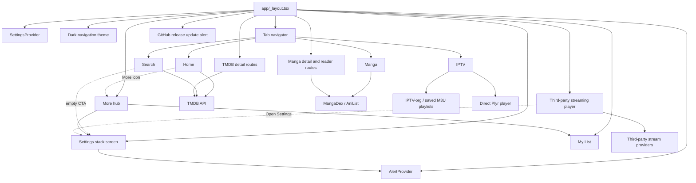

# Yummy Project Memory

## Snapshot

**Yummy** is a personal media client (`v2.3.0`) that combines:

1. TMDB discovery for movies, TV shows, people, cast, and recommendations.
2. Configurable third-party streaming-provider embeds (`app/player.tsx`: WebView on native, `<iframe>` on web/Tauri) plus a native Catalog Service player (`components/CatalogPlayer.tsx`) that runs against a service domain the user supplies in Settings.
3. Public direct IPTV playback from IPTV-org and saved M3U playlists.
4. Manga discovery and reading via MangaDex and AniList.

The app is an Expo Router application with a dark, Netflix-inspired visual system: black/surface/card layers, red accent (`#e50914`), quiet uppercase labels, radius-8 chrome, white primary CTAs, and bundled Geist Mono (**Regular / Medium / SemiBold / Bold** only). Android is configured as `com.kunalkongkan.yummy`; web uses Expo static output. Desktop (Win / Linux / macOS) is a Tauri 2 shell around that web export (`src-tauri/`, identifier `com.kunalkongkan.yummy`). The native Android directory may exist locally but is ignored by Git.

## Runtime Structure

## Route Inventory

| Route | Role | Important parameters / dependencies |
| --- | --- | --- |
| `/(tabs)` | Bottom-tab shell | Defined by `app/(tabs)/_layout.tsx` |
| `/(tabs)/index` | Home discovery | TMDB credential; optional TMDB provider filter; More (⋯) icon |
| `/(tabs)/search` | TMDB multi-search | TMDB credential; search starts at 3 characters |
| `/(tabs)/manga` | Manga source selector/search | MangaDex or AniList network access |
| `/(tabs)/iptv` | IPTV playlist, group, and channel browser | IPTV-org plus saved M3U / custom channels |
| `/more` | Hub for My List, Watch History, Settings, future links | Stack screen; opened via More (⋯) on Home |
| `/my-list` | Full watchlist | `LibraryContext` watchlist |
| `/watch-history` | Recently played titles | `LibraryContext` watch history |
| `/settings` | Stream provider, Catalog Service domain/activation, TMDB, IPTV playlists/channels | Stack screen; via More or direct CTA |
| `/details` | Movie/TV metadata, cast, seasons, recommendations | `id`, `type` (`movie`/`tv`) |
| `/person` | TMDB person profile and credits | `id` |
| `/iptv-player` | Direct Plyr IPTV playback | `channelName`, `streamUrl` |
| `/manga-details` | Source-specific metadata and chapter selection | manga ID, source, display metadata |
| `/manga-reader` | Page reader with zoom/pan and navigation | chapter ID/title, manga title, source |
| `/player` | Third-party stream provider embed | `id`, `type`, `title`, `season?`, `episode?` — WebView native / iframe web; the Catalog Service provider routes to `components/CatalogPlayer.tsx` |

Root navigation is in `app/_layout.tsx`. It preloads the four Geist Mono weights, holds the splash until fonts resolve, wraps routes in `SettingsProvider` and `AlertProvider`, forces React Navigation's dark theme, and invokes `useVersionCheck()`.

## State Ownership and Persistence

### `SettingsContext`

`contexts/SettingsContext.tsx` owns all app-level settings:

| Value | Default | AsyncStorage key |
| --- | --- | --- |
| `streamUrl` | empty until user picks a provider | `@stream_url` |
| `tmdbApiKey` | empty string | `@tmdb_api_key` |
| `tmdbDnsEnabled` | `false` | Android SharedPreferences `yummy_tmdb_dns/enabled` (native-startup exception, not AsyncStorage) |
| `streamProvider` | empty until user picks after disclaimer | `@stream_provider` |
| `streamDisclaimerAccepted` | `false` | `@stream_disclaimer_accepted` (`1` when accepted) |
| `catalogDomain` | empty until the user saves a domain | `@catalog_domain` |
| `catalogSession` | `null` until activated | `@catalog_session` (JSON: `tHashT`, `baseUrl`, `setAt`) |
| `iptvPlaylists` | IPTV-org categories plus custom entries | `@iptv_playlists` (custom only) |
| `iptvChannels` | empty | `@iptv_channels` |
| `iptvFavorites` | empty | `@iptv_favorites` |
| `iptvRecentChannels` | empty, max 20 | `@iptv_recent_channels` |

Custom channels (`iptvChannels`) are individual direct stream URLs. They are marked `isCustom: true`, appear in the IPTV tab, and bypass M3U parsing.

Use `useSettings()` instead of direct AsyncStorage access in product features. Settings load asynchronously after mount; screens must tolerate defaults until persisted values arrive.

### Library (watchlist / continue watching / history / episodes)

`contexts/LibraryContext.tsx` stores TMDB titles in AsyncStorage:

| Value | AsyncStorage key | Cap |
| --- | --- | --- |
| Watchlist | `@library_watchlist` | 200 |
| Continue watching | `@library_continue_watching` | 20 |
| Watch history | `@library_watch_history` | 100 (one row per title, latest play) |
| Watched TV episodes | `@library_watched_episodes` | map of `tvId` → `["season:episode", ...]` |
| Watched movies | `@library_watched_movies` | movie id list |

Details bookmark toggles watchlist; starting playback records history, marks the TV episode watched, and (when advancing) moves continue watching to the next episode. Movies marked watched (play or tick) are removed from continue watching and kept in history only. Season lists expose per-episode checkmarks via `toggleEpisodeWatched`. Full My List lives at `/my-list`; history at `/watch-history` via `/more`. Provider chips are TMDB “browse by service” filters — distinct from Settings embed stream providers. Prefer AsyncStorage over SQLite for this scale.

## Data and External Contracts

### TMDB

`hooks/useTMDB.ts` is the canonical client for discovery, search, media details, credits, recommendations, person profiles/credits, top-rated, upcoming, and TV season episodes. Values beginning with `eyJ` or longer than 100 characters are treated as bearer tokens; otherwise an API key query parameter is used. Shared types: `Movie`, `Season`, `Episode`, `CastMember`, `PersonDetails`, `PersonCredit`.

Screens should call `useTMDB()` methods only — do not duplicate auth headers in route files.

Android has an opt-in **Use Cloudflare DNS for TMDB** row under Settings → General → Connection. `modules/yummy-tmdb-dns/` is a local Expo module; its application lifecycle listener restores the flag from SharedPreferences before JS starts and installs an `OkHttpClientProvider` factory, covering fetch/axios and Fresco (`Image`). Only `api.themoviedb.org` and `image.tmdb.org` use DoH (`okhttp-dnsoverhttps:4.9.2`, Cloudflare's HTTPS endpoint bootstrapped to IPv4/IPv6 addresses, 6 s call timeout, 1 MiB HTTP cache); unavailable/empty DoH results fall back to device DNS. Normal TLS/hostname verification and the React cookie-jar container remain intact. `utils/tmdbDns.ts` exposes an optional module bridge; `useSettings()` owns the UI state and setter. Toggling evicts idle pooled connections and reloads Home discovery; it does not change Android Private DNS. Other platforms and Expo Go retain normal networking. Native unit tests: `./gradlew :yummy-tmdb-dns:testReleaseUnitTest` from `android/` (seven cases, no credentials/network); a live JVM check also reached the API and fetched a poster with system DNS deliberately unavailable.

Provider-filtered popularity uses the `IN` region. Curated provider IDs/logos live in `constants/providers.ts`. Embed providers live in `constants/streamProviders.ts` (real names + hostnames; no alias nicknames). Playback requires accepting the third-party stream disclaimer (`constants/streamDisclaimer.ts`, gated via `utils/streamPlaybackGate.ts`) and selecting a provider in Settings — there is no silent default embed.

### Catalog Service (native player provider)

The Catalog Service is a **native-only** stream provider (`CATALOG_PROVIDER_ID = 'catalog'` in `constants/streamProviders.ts`, entry `{ id, name: 'Catalog Service', baseUrl: '', constructUrl: () => '' }`). Yummy ships **no** service domain — the user enters their own in Settings (`catalogDomain`) — so everything below is service-agnostic and built from that value:

- Domain: `constants/catalog.ts` holds no host and no domain pool. `normalizeCatalogDomain()` turns user input into an `https://host` origin (public HTTPS only); `hooks/useCatalog.ts` builds every request from the saved `catalogDomain`.
- OTT namespaces: a service implementing this protocol can mirror several catalogs under separate path namespaces — `nf` (`/mobile/...`, default), `pv` (`/mobile/pv/...`), `hs` (`/mobile/hs/...`). Each namespace has its own `search.php`, `post.php`, `episodes.php`, `playlist.php`. `resolvePlaybackTarget()` searches **all namespaces in parallel** and auto-picks the catalog that has the title (kind hints from the search `r` field + exact-title scoring); the user never selects an OTT.
- Match verification (`utils/catalogMatch.ts`): the service's catalog exposes **no TMDB ids** — a search hit carries only `{id, t, y?, r?}` — so a hit is a candidate, not a resolution. `resolvePlaybackTarget()` takes optional `criteria` = `{year, castNames, directorNames}` (built by `useTMDB().fetchMatchCriteria(tmdbId, type)` from `release_date`/`first_air_date` + top 8 billed cast + movie `Director` crew / TV `created_by`; both TMDB calls run in **parallel** because this is on the playback path) and checks each candidate's `post.php` details (`year`, `cast`, `director`, `creator`) against them. Rules strongest-first: **≥2 shared cast names**; matching year (±1, `MATCH_YEAR_TOLERANCE`) **plus ≥1** shared cast/director/creator; matching year when the service returns no people or only a year is comparable. `evaluateCatalogMatch()` returns a **three-state** `verified`: `true` (compared and agreed), `false` (compared and disagreed), `null` (nothing to compare — no criteria supplied, **or** the entry exposed no year/people at all; absence of evidence is not disagreement). The resolver plays the first `true`; otherwise it falls back to the best-ranked candidate, preferring `null` entries over `false` ones, and carries the state to `CatalogPlayer`, which shows **"Possible mismatch"** (accent) for `false` or **"Match unchecked"** (amber) for `null` — never silently. Episode ids are resolved only for the candidate about to play, so a confirmed match costs the same requests as before. Year agreement also participates in `rankCatalogHits()` scoring, so the right remake sorts first.
- Activation (one-time, ~12h): Settings → Catalog Service → Activate. `startActivation()` fetches `data-addhash` from `{domain}/mobile/home?app=1` and builds `{adHost}/?ffr455=<addhash>&a=y&t=<ts>` where `adHost` = `userver.<domain>` (`CATALOG_AD_SUBDOMAIN` + `catalogAdHost()`); Settings opens it with `Linking.openURL`, and `pollActivation()` POSTs `{domain}/mobile/verify2.php` every 5 s (timeout 180 s) until `statusup === "All Done"`. The `t_hash_t` cookie is captured from the response (falling back to the platform cookie jar), optionally confirmed with `verifySession()` against `{domain}/mobile/post.php?id=1`, and stored in `catalogSession`. `CATALOG_SESSION_TTL_MS` = 12 h. The activation host is **derived** as `userver.<domain>`, not discovered — unverified for domains other than the one originally tested.
- API (needs session): per-namespace `search.php?s=` (the default `/search.php` works unverified), `post.php?id=` (details, TV seasons list), `episodes.php?s=<seasonId>&series=<showId>&page=` (10/page), `playlist.php?id=` (tokenized HLS sources + caption tracks). `nf` IDs are numeric; `pv`/`hs` IDs are alphanumeric.
- Playback (`components/CatalogPlayer.tsx`): the resolved HLS lives on CDNs that require `Referer: {domain}/`. The player loads a real page on the user's own domain in a WebView (correct origin/Referer), injects an early script (`window.__yummyCatalogPlayer` single-init guard; neutralizes `window.open`, strips `data-addhash` so the site's ad polling stops) and a main script that fetches the namespace `playlist.php` same-origin, then builds a **Plyr + hls.js** player with custom **Audio** (multi-language `EXT-X-MEDIA` tracks from hls.js `audioTracks`) and **Quality** (hls.js levels) menus, plus a caption menu (SRT → VTT converted in-page, English-first). Requests outside the `{domain}/` origin are blocked; the load timeout is 40 s. Streams without a session contain `in=unknown` → "session expired" state. On web/Tauri the player shows a native-playback-required state.

Do not log Catalog Service session tokens; the session is device-local AsyncStorage only.

### Android offline downloads

`modules/yummy-downloads/` is an autolinked local Expo module using Media3 1.8.0. CatalogPlayer hands its resolved HLS/caption URLs to `app/player.tsx`; `components/DownloadSheet.tsx` asks the native manifest inspector for available quality/audio/caption choices. Native short-lived preparation tokens validate track indices and generate one variant + compatible audio + optional subtitle stream keys. External SRT/VTT uses a paired progressive download. Video completion requires the sidecar too. Stream URIs may contain tokens and must never be logged or returned in JS library snapshots.

Media3 owns its private SQLite index and non-evicting media cache (`filesDir/offline-videos`); this is a native-media exception to AsyncStorage-only app state. `YummyDownloadService` runs foreground downloads with network requirements and persistent pause/resume/remove controls. `app/downloads.tsx` (More → Downloads, Android) polls while focused; `app/download-player.tsx` uses `OfflineVideoView` with no HTTP upstream, so completed videos and selected captions play from cache. Removal deletes both video and sidecar. Only finite HLS from Catalog Service is supported initially. Device tests use an isolated test app and public Shaka media: `./gradlew :yummy-downloads:connectedReleaseAndroidTest`.

Download UX now includes title/episode-aware notifications and direct icon actions beside Watch Now and on TV episodes (Catalog Service / Android). Direct selection uses the existing catalog matcher and stream resolver, never playback/history recording, and cancels on Details blur. `DownloadArtwork` saves validated, bounded TMDB poster images in private `offline-posters` files using the existing RN OkHttp/DNS path. Snapshots expose local poster URI + TMDB identity for older-download artwork backfill; native `requestPoster` restores missing art. Removal deletes artwork. Snapshot metadata carries `showTitle`/`season`/`episode` (legacy TV ids parsed for season/episode), so Downloads groups TV episodes into show cards with season accordions, inline header Play/Pause, pause-all/resume-all, status pills, pull-to-refresh, and auto-reveal of in-progress shows. The native Media3 offline player remains in place; the requested Plyr replacement was explicitly put aside by the user.

### IPTV

`constants/iptv.ts` defines the built-in IPTV-org category playlist. `hooks/useIptv.ts` parses `#EXTINF` into validated `IptvChannel` records, accepts only public HTTPS playlists without embedded credentials, accepts public direct HTTP(S) streams, caps playlists at 20,000 channels / 10 MB, and ignores playlist-provided header directives. The IPTV tab uses a virtualized `FlatList`, group/query filters, favorites/recents, and ignores stale load responses. `app/iptv-player.tsx` plays public HLS or MP4/M4V/WebM via hls.js + Plyr (WebView on native, `iframe` + `srcDoc` on web/Tauri with `parent.postMessage` bridge); it fails closed after 25 seconds for bad/DRM/origin-restricted streams.

### Manga

| Source | Discovery/details | Reading | Notes |
| --- | --- | --- | --- |
| MangaDex | `api.mangadex.org` | At-Home server URLs | English chapter feed |
| AniList | `graphql.anilist.co` | Consumet AniList manga endpoint | Metadata primarily; Consumet reading is unstable |

Source selection lives in `app/(tabs)/manga.tsx`. `manga-details.tsx` fetches source-specific details and opens the reader when chapters exist. The reader uses Gesture Handler / Reanimated for pinch/pan.

### Updates

`useVersionCheck()` compares GitHub Releases for `kunalkcube/yummy` with the running app version. On native it uses `expo-application`'s `nativeApplicationVersion`; on web/Tauri that API is always `null`, so it falls back to `Constants.expoConfig.version` (`app.json`). Root layout shows `UpdateAlert` when a newer release exists.

### Alerts

`components/AppAlert.tsx` provides a custom modal dialog. Imperative API: `AppAlert.alert(title, message?, buttons?)` with optional `cancel` / `destructive` / `default` button styles. `AlertProvider` must stay mounted in the root layout. Do not use React Native `Alert`.

## UI and Component Boundaries

- Design tokens: `constants/colors.ts`, `constants/fonts.ts` (four Geist Mono weights only).
- Desktop shell: `components/layout/ScreenContainer.tsx` centers content at `CONTENT_MAX_WIDTH` (896) when width ≥ 768 (`useIsDesktop`). Below that, mobile layout matches pre-desktop (no max-width column, uncapped heroes/cards, FlatList rows, no chevrons). `MovieCard` clamps 110–170 only on desktop. Tab chrome and `HorizontalScrollRow` chevrons follow the same breakpoint. Players stay full-bleed; web/Tauri uses `iframe`.
- Bottom tabs: Home, Search, Manga, IPTV (4). More hub at `/more` (My List, Watch History, Settings); Settings at `/settings`.
- Shared chrome language: quiet uppercase labels, radius 8, white primary buttons, accent-border selection, Lucide `Star` for ratings, safe-area aware headers, translucent player chrome.
- `MovieRow` / `MovieCard` — Home (and similar) horizontal lists → `/details`.
- `ProviderChips` — TMDB watch-provider filter on Home.
- `SeasonsList` — lazy season episodes with pagination.
- `CatalogPlayer` — native Catalog Service playback (WebView at the user's domain origin + hls.js; activation-gated).
- `AppAlert` — all confirmations and success/error dialogs.
- `UpdateAlert` — GitHub release prompt (same visual language as `AppAlert`).

Expo starter artifacts (themed components, `/modal`, `EmptyState`, debug helpers, unused font weights, `constants/theme.ts`) have been removed.

## Environment and Secrets

- `.env` is gitignored and must stay local. A real `TMDB_API_KEY` may exist there for local tooling; product code does **not** read it — users enter TMDB credentials in Settings.
- Never commit API keys, bearer tokens, device secrets, or signing credentials.
- Do not log credential prefixes, lengths, or Authorization headers.
- Privacy: Yummy has no backend/server. Device-local AsyncStorage plus native SharedPreferences for the Android DNS flag; optional TMDB DNS queries go to Cloudflare. See Settings → About.

## Build, Quality, and Repository Facts

- Runtime: Expo SDK 57 / React Native 0.86 / React 19.2 / TypeScript 6.
- Package manager: npm with committed `package-lock.json`.
- Commands: `npm start`, `npm run android`, `npm run ios`, `npm run web`, `npm run lint`, `npm run reset-project`, `npm run prebuild:android`, `npm run android:apk`, `npm run tauri:dev`, `npm run tauri:build`.
- Splash / Android adaptive icon background: `#000000`. New Architecture is required (SDK 55+); do not set `newArchEnabled` or `android.edgeToEdgeEnabled` in `app.json`.
- TypeScript is strict; `@/*` resolves from the repo root.
- ESLint: Expo flat config (`eslint-config-expo` ~57); ignores `dist/*`. `react-hooks/set-state-in-effect` is off for intentional screen fetch effects.
- Tab bar types come from Expo Router’s vendored React Navigation (`expo-router/js-tabs` / `expo-router/react-navigation`). Do not import `@react-navigation/*` in app code (SDK 56+).
- `useTMDB` methods are `useCallback`-stable so screen load effects do not re-fire every render.
- Tauri 2: `@tauri-apps/cli` in devDependencies; `src-tauri/tauri.conf.json` uses `frontendDist: ../dist`, `devUrl: http://localhost:8081`, `beforeDevCommand: npx expo start --web`, `beforeBuildCommand: npx expo export -p web`. Desktop bundles land in `src-tauri/target/release/bundle/`.
- `metro.config.js` must block `src-tauri/**` from Metro's watcher; otherwise `tauri:dev` crashes when cargo creates/deletes temp files under `target/debug/deps`.
- No automated test framework or in-repo CI release pipeline; personal APKs via disposable `android/` prebuild + `npm run android:apk`; desktop via `npm run tauri:build`. Keep keystores/signing credentials out of git.
- Android release: `plugins/withAndroidRelease.js` + `expo-build-properties` (R8 minify, shrinkResources, ABI splits, NDK pin). Signing reads `credentials/android/release.keystore` + `keystore.properties` (gitignored); never under `android/app`. Scripts: `npm run prebuild:android`, `npm run android:apk`. APKs named `yummy-v{version}-{abi}-release.apk` (plus universal).
- Ignored: `dist/`, `.expo/`, `node_modules/`, `.env`, generated `/android` and `/ios`, `credentials/android/*.keystore`, `credentials/android/keystore.properties`, `src-tauri/target/`, `src-tauri/gen/schemas`.
- Active branch historically: `github`; `v2.0.0` is the initial release tag.

## Known Maintenance Risks

1. **IPTV and scraper volatility:** Streams, MangaDex, and Consumet can break without app changes. Keep parsing defensive; test on device.
2. **Large remote playlists:** IPTV-org is large (~14k channels). Keep lists virtualized; do not persist full remote playlists without a retention design.
3. **No JavaScript test runner:** Rely on lint/typecheck plus manual navigation and failure-path checks; the native TMDB DNS module has focused JUnit tests.
4. **Untrusted media surfaces:** User stream URLs and embedded WebViews/iframes are untrusted. On web/Tauri, `react-native-webview` is unsupported — players use native `iframe`. Keep URL validation, navigation allowlists, and log redaction.

## Update Guidance

Refresh this file when routes, persistence keys, runtime versions, API auth, IPTV/Manga contracts, UI system tokens, alert usage, quality commands, or known risks change. Keep it factual and short enough for session context.

---

# Session Log

## Session — 2026-11-01: `context/` rewrite for Yummy

### What was built

- Rewrote all 10 files in `context/` (`README`, `project-overview`, `architecture`, `code-standards`, `library-docs`, `ui-tokens`, `ui-rules`, `ui-registry`, `build-plan`, `progress-tracker`). The previous contents documented an unrelated Next.js magazine project (Supabase / Razorpay / Tailwind / admin CMS) that had been copied in from elsewhere; none of it described Yummy.
- New docs are derived from a full read of the source: 16 route files, 12 components, both contexts, all 5 hooks, all constants, `plugins/withAndroidRelease.js`, `src-tauri/`, and the config files.
- Established `ui-registry.md` with a written baseline table (colors, radius, type, spacing, buttons) plus per-component pattern entries, so future UI work has one place to check.

### Decisions made

- **`context/` is the day-to-day agent guide; `MEMORY.md` remains the long-form architecture reference.** Authority order recorded in `context/README.md`: `AGENT.md` → `context/` → `MEMORY.md` → vendor docs.
- **Session memory is appended to `MEMORY.md` as a dated section, not written to a lowercase `memory.md`.** The `remember` skill defaults to `memory.md`, which on macOS/Windows is the same file as the tracked `MEMORY.md` and would clobber it. Append here instead.
- **`build-plan.md` documents candidate slices only — no invented roadmap.** Every item is marked as needing confirmation before work starts.
- **Documented gaps are labelled as gaps** (missing stale-response guards, no search debounce) rather than presented as finished work.

### Problems solved

- **Staged Android signing credentials.** `credentials/android/keystore.properties.bak-20261020-011655` was staged for commit and held real password values (its `keyAlias` matched the live file while its passwords differed from the `.example` template). The existing ignore rule only covered the exact name `keystore.properties`, so a `.bak-` sibling slipped through. Unstaged it and added `credentials/android/keystore.properties.*` to `.gitignore`, with a `!…keystore.properties.example` negation so the template stays trackable. The file was never committed or pushed, so no rotation is needed.
- **Verified doc accuracy mechanically instead of trusting recall.** 23 numeric claims (library/IPTV caps, `CONTENT_MAX_WIDTH` 896, `DESKTOP_MIN_WIDTH` 768, 20k-channel and 10 MB IPTV limits, 25 s / 40 s player timeouts, Plyr 3.8.4, hls.js 1.5.18, 5 s poll / 180 s activation timeout, 12 h NetMirror TTL) and all 14 AsyncStorage keys were checked against source in a scripted pass.
- **Corrected three claims that were wrong on first draft:** there are no `Switch` controls and no `keyboardDismissMode` usage anywhere; filter chips convey selection visually only and lack `accessibilityState`; and the stream-provider list is 11 embed hosts + `custom` + the native `netmirror` entry (not 12 embeds).

### Current state

- `context/` accurately describes the codebase as of v2.2.0 (post-NetMirror work).
- `npx tsc --noEmit` exits 0. No lint or test run was needed for documentation-only changes.
- Known real gaps recorded in `context/progress-tracker.md`: Search, Details, Person, and Manga-details loaders have no stale-response guard; Search fires a TMDB request per keystroke past 2 characters and has no debounce; AniList reading depends on the unstable Consumet endpoint.
- `credentials/android/keystore.properties.bak-20261020-011655` still exists on disk (now gitignored) — harmless, but deleting it is tidier.

### Next session starts with

Pick a slice from `context/build-plan.md`. Highest value by its own assessment: add stale-response guards to the four unguarded loaders (copy the IPTV `playlistRequestId` ref pattern or Home's `cancelled` flag), then add a ~250–300 ms debounce to Search on top of that guard.

### Open questions

- Whether the accumulated pre-`context/` work (NetMirror player, IPTV player rewrite, desktop/Tauri updates) should have been split into its own commit rather than landing with the documentation rewrite.
- Whether to adopt a lint/typecheck gate before committing, since the repo still has no test runner and no CI.

## Session — 2026-11-01: service-agnostic catalog refactor + doc sync

### What was built

- Replaced the hardcoded, reverse-engineered streaming integration with a service-agnostic, user-supplied-domain design. Yummy ships **no** service domain now.
- Deleted `constants/netmirror.ts`, `hooks/useNetMirror.ts`, and `components/NetMirrorPlayer.tsx` (hardcoded host, base64 domain pool, ad host, session TTL).
- Added `constants/catalog.ts` (service-agnostic: `CATALOG_SESSION_TTL_MS` 12 h, `CATALOG_STORAGE_KEYS` `@catalog_session` / `@catalog_domain`, `CATALOG_HOME_PATH`, `CATALOG_STATUS_PATH`, `CATALOG_HEADERS`, `CATALOG_AD_SUBDOMAIN` `'userver'`, `catalogAdHost(domain)`, `normalizeCatalogDomain(input)`, `CATALOG_OTT_NAMESPACES` `['nf','pv','hs']`, `catalogOttPath()`, `catalogSearchPath()`, and the `Catalog*` types). No domain pool and no hardcoded host.
- Added `hooks/useCatalog.ts` (replaces `useNetMirror`) exposing `{ isConfigured, isActive, isSessionFresh, session, search, searchAll, fetchDetails, fetchEpisodes, resolveStream, resolvePlaybackTarget, startActivation, pollActivation, deactivate }`. `isConfigured` = a domain is saved; `isSessionFresh` also requires `session.baseUrl === catalogDomain`; there is no `discoverBaseUrl` any more.
- Added `components/CatalogPlayer.tsx` (renamed from `NetMirrorPlayer`, export `CatalogPlayer`) with props `{ title, type, season?, episode?, baseUrl }`; early guard `window.__yummyCatalogPlayer`; gates in order `!isConfigured` → `!isActive` → `!isSessionFresh` → web.
- Updated `constants/streamProviders.ts` (`CATALOG_PROVIDER_ID = 'catalog'`, entry `{ id: 'catalog', name: 'Catalog Service', baseUrl: '', constructUrl: () => '' }`), `contexts/SettingsContext.tsx` (`catalogDomain` / `catalogSession`, `setCatalogDomain` / `saveCatalogSession` / `clearCatalogSession`; new keys), `utils/streamPlaybackGate.ts` (both functions take `catalogDomain`), `app/player.tsx` (`<CatalogPlayer … baseUrl={catalogDomain} />`), `app/settings.tsx` ("Catalog Service" section: domain input + Save, status row, Activate/Re-activate/Deactivate), and the Home/Details gate callers.
- Updated all 11 docs (`AGENT.md`, `MEMORY.md`, `README.md`, and the eight `context/` files that described the old provider) to the new design and appended this log entry.

### Decisions made

- **Service-agnostic by design.** No host, no fallback list, no domain pool in the bundle. The user supplies the domain in Settings and every request plus the WebView origin derives from it.
- **Provider naming.** `CATALOG_PROVIDER_ID = 'catalog'`, display name "Catalog Service", `baseUrl: ''` so nothing service-specific ships; the player resolves the origin from settings at runtime.
- **Switching domains invalidates the session.** `setCatalogDomain` normalizes input, throws on invalid input, no-ops when unchanged, and clears any saved session when the domain actually changes — so a stale cookie can never be sent to a different host.
- **Old service named only where it describes what was removed.** Live docs use generic phrasing; the historical session-log entry above is left intact.

### Problems solved

- **Removed the load-bearing hardcoded host.** The old integration's single hardcoded origin, base64 domain pool, and discovery call were the riskiest parts of the streaming path. They are gone; the same care now applies to the `Referer: {domain}/` assumption and the derived activation host.
- **Residual risk to watch: activation host is derived, not discovered.** `catalogAdHost(domain)` builds `userver.<domain>` from the observed service shape. This is unverified for any domain other than the one originally tested — activation is the first thing to check if a new domain misbehaves.
- **Doc/code drift.** Docs still described the old service, its session setting, the discovery flow, and the old file names. Every reference was rewritten to `catalogDomain` / `catalogSession` / `Catalog Service` / the new file paths.

### Current state

- `npx tsc --noEmit` passes clean; `npm run lint` passes with 0 errors and 0 warnings.
- All docs describe the service-agnostic design; a `*.md` grep for the old service name returns only the historical session-log entry above (allowed) and no live references.
- Known gaps carried forward: stale-response guards for Search/Details/Person/Manga-details, and no search debounce.

### Next session starts with

Pick a slice from `context/build-plan.md`. Unchanged highest-value item: stale-response guards for the four unguarded loaders, then a ~250–300 ms Search debounce. Player-value item: Catalog Service session UX (a visible remaining-time countdown and a prominent re-activate when `isSessionFresh` is false).

### Open questions

- Whether the derived `userver.<domain>` activation host holds for other services/protocols, or whether activation needs a discovery step for domains that use a different ad subdomain.
- Whether to keep supporting domains that implement this protocol only partially (e.g. no `pv`/`hs` namespaces) and how failures should read in the UI.

## Session — 2026-11-01: v2.3.0 — Settings redesign, TMDB DNS toggle, Home fixes, offline downloads

### What was built

- **Settings redesign** (`app/settings.tsx`, full rewrite): four-tab layout (General / Playback / IPTV / About) with fixed header, TMDB setup first, compact provider selector with contextual Catalog Service / Custom URL setup, show/hide credential toggle with inline TMDB test results, IPTV saved-sources-first with expandable add forms, unsaved-change indicators and draft preservation across tabs. Registry updated in `context/ui-registry.md`.
- **Android Cloudflare DNS toggle** (`modules/yummy-tmdb-dns/`, `utils/tmdbDns.ts`, `contexts/SettingsContext.tsx`, `app/settings.tsx` General → Connection): local Expo module installs an `OkHttpClientProvider` factory covering fetch/axios + Fresco images; only `api.themoviedb.org` / `image.tmdb.org` use DoH (`okhttp-dnsoverhttps:4.9.2` matching RN's OkHttp), with device-DNS fallback and in-flight lookup sharing. Flag persists in SharedPreferences (`yummy_tmdb_dns/enabled`) so it applies before JS; exposed via `useSettings()`.
- **Home loading fixes** (`app/(tabs)/index.tsx`, `hooks/useTMDB.ts`): rows render progressively (first success dismisses the full-screen loader), More (⋯) header stays available during loading/failure with a retry CTA, all TMDB hook requests have 15 s deadlines, native TMDB-only connect/read bounds 4/10 s.
- **Android offline downloads** (`modules/yummy-downloads/`, `utils/downloads.ts`, `components/DownloadSheet.tsx`, `app/downloads.tsx`, `app/download-player.tsx`, entry points in `app/details.tsx` + `app/player.tsx` + `components/SeasonsList.tsx`): Media3 1.8.0 native module. Resolution/audio/caption picker reads the real HLS manifest (short-lived preparation token, one variant + compatible audio + optional subtitles as stream keys); paired caption sidecar must complete before "Ready"; foreground `YummyDownloadService` with title/episode-aware notifications; poster artwork saved privately with legacy backfill; offline playback via cache-only `OfflineVideoView` (native Media3, no HTTP upstream). Downloads screen organizes TV episodes into show → season accordions with status pills, inline header Play/Pause, pause-all/resume-all, pull-to-refresh, and auto-reveal of in-progress shows. Direct download actions beside Watch Now and on episode rows never record watch progress.
- **v2.3.0 release**: version bumped (`app.json` + `package.json`, versionCode 4), prebuild regenerated, all five signed APKs verified (signature, 16 KB alignment, manifest) and the arm64 build installed on the connected device (user 11 work profile).

### Decisions made

- **Media3 (native) stays the offline player.** The user asked about Plyr for offline; answer was no — Plyr is WebView/JS-only, and cache-only Media3 is the reliable offline path. User explicitly put the player aside.
- **App-only DNS, not system Private DNS.** Android restricts global Private DNS changes to device owners; the in-app DoH toggle covers Yummy only, off by default, Cloudflare endpoint bootstrapped to 1.1.1.1/1.0.0.1 + IPv6.
- **Downloads are Catalog Service sources only.** Embedded webpage providers and live IPTV are not download sources; only finite, non-CDM-protected HLS.
- **Media3's native SQLite index + private cache** (`filesDir/offline-videos`, posters in `filesDir/offline-posters`) is a documented exception to AsyncStorage-only state. Stream URLs/tokens never leave the device or appear in JS list snapshots.
- **TV grouping metadata** (`showTitle`/`season`/`episode`) lives in native download metadata; legacy `catalog_<tmdb>_tv_<s>_<e>` ids are parsed for season/episode so old downloads group correctly.
- **Session log convention kept**: appended here rather than a lowercase `memory.md` (same file on case-insensitive filesystems).

### Problems solved

- DNS startup cost: concurrent TMDB lookups now share one in-flight FutureTask per host (no second TTL cache); IPv4 preferred with IPv6 retained.
- Downloaded-video notifications showed a generic label — now derived from each download's title metadata, grouping by parent video.
- Home's three-dot menu vanished during loading (full-screen loader replaced the header) — loader now renders under a persistent top bar.
- Device test flake: the phone locked mid-instrumentation ("Activity never becomes RESUMED") — the isolated test activity now sets keep-screen-on/show-when-locked flags.
- Test-harness gotchas: JSX `E{episode}` yields a children array (flatten before comparing); react-test-renderer `type` prop must be read via `evaluate`, not `getAttribute`.
- `git diff --check` false positives on details.tsx/player.tsx: the staged index copies are CRLF; files normalized to consistent CRLF to match (HEAD is LF — expect whitespace flags on new lines vs HEAD until re-staged/committed).

### Current state

- v2.3.0 (versionCode 4) built, all five APKs verified and signed; arm64 installed on the device's work profile (user 11).
- Lint + `npx tsc --noEmit` clean; 2 native device integration tests pass (track selection/pause/resume/cache-only playback/delete + external captions, poster save/restore/cleanup, show/season metadata); UI-flow harness and 320/390/1280 px browser checks pass; live JVM DNS check reaches TMDB with device DNS failing.
- The uncommitted working tree (this commit) includes the whole v2.2.0→v2.3.0 arc: catalog refactor, Settings redesign, DNS toggle, Home fixes, downloads, docs.
- Phone testing of a real user-configured Catalog Service source end to end still outstanding; downloads were verified with public Shaka sample media in an isolated test app.

### Next session starts with

Push/tag `v2.3.0` on GitHub (user's `github` branch) so the in-app update checker offers it, after the user confirms; otherwise pick from `context/build-plan.md` (stale-response guards + search debounce remain the top items). The work profile (user 11) must be unlocked for on-device app checks.

### Open questions

- Whether the user wants the offline player restyled later (explicitly deferred this session).
- Whether episode-level artwork (stills) should eventually replace the shared show poster in episode rows.
- Whether a "downloads storage cap / cleanup" setting is wanted once libraries grow.

