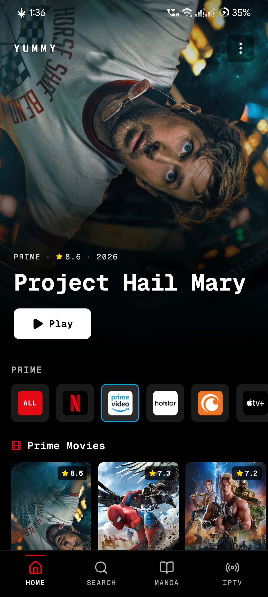
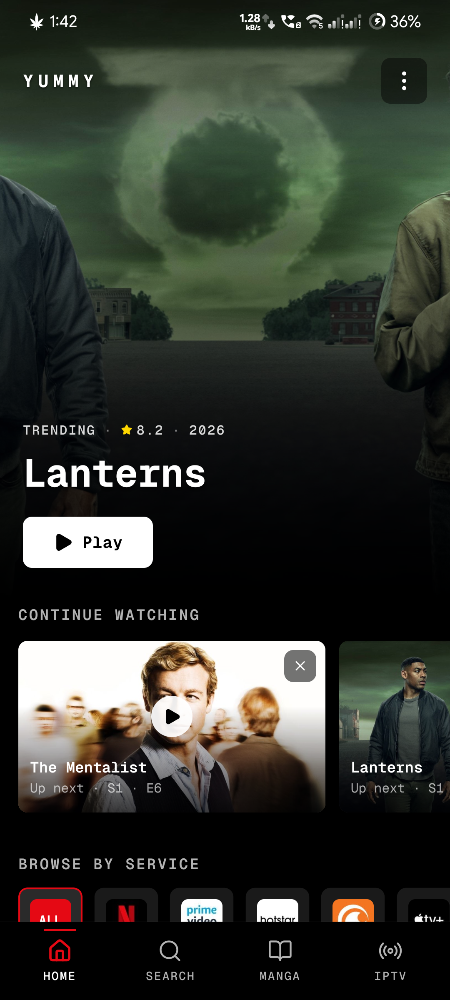
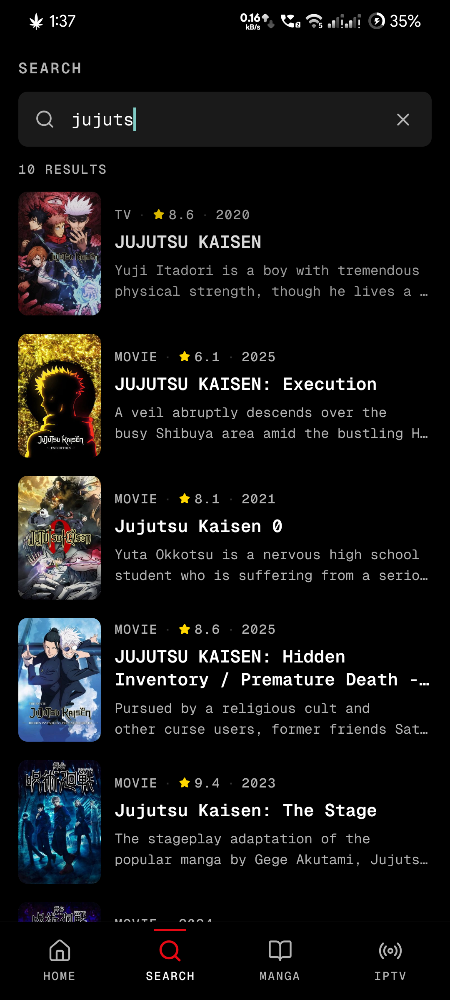
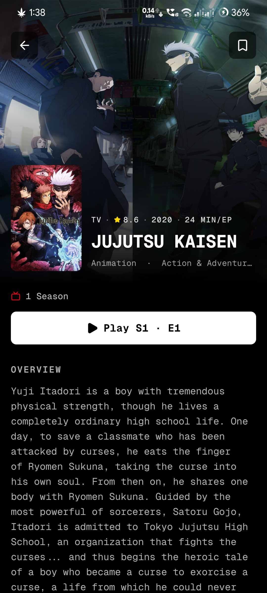
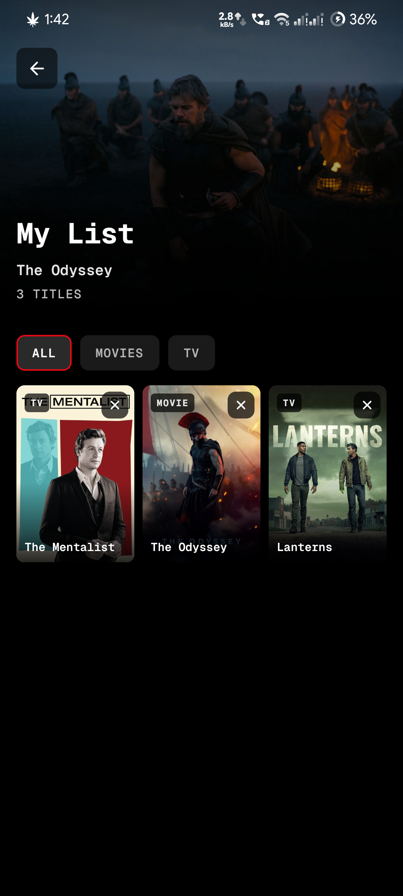
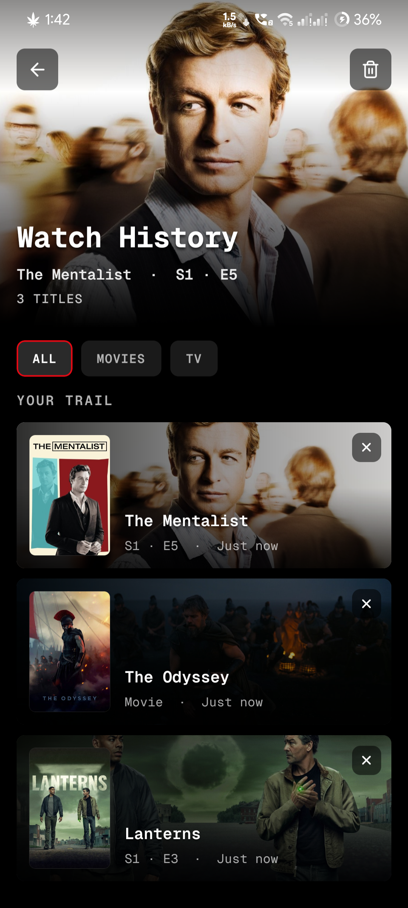
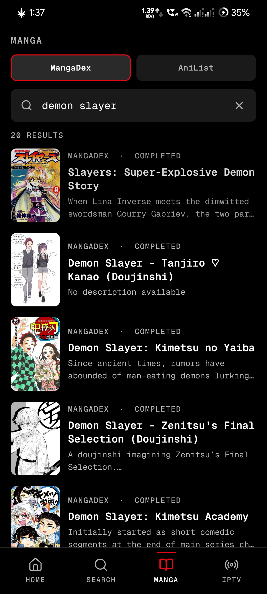
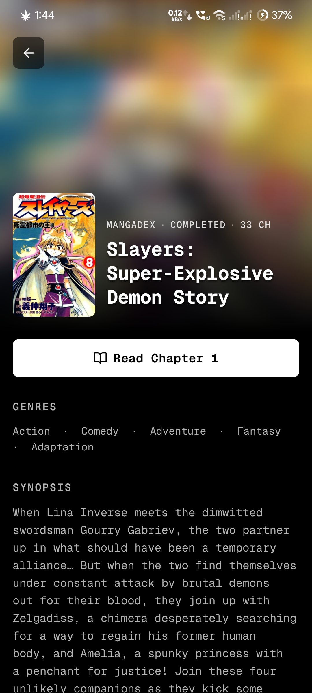
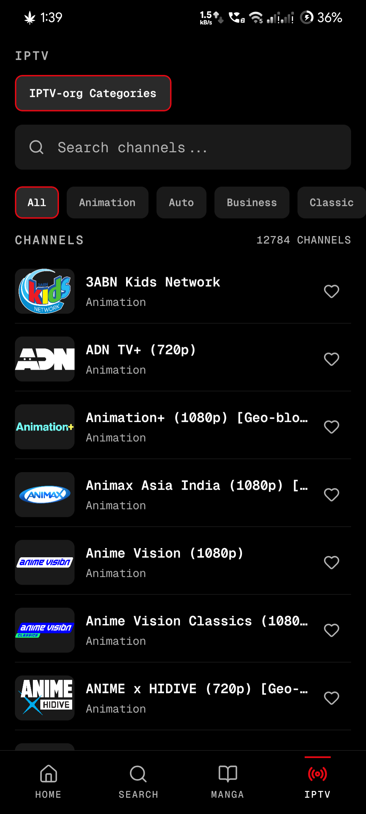

# Yummy

Personal media client for movies, TV, manga, and IPTV — built with React Native and Expo.

**v2.3.0** · dark Netflix-inspired UI · no Yummy backend (everything stays on-device)

<p align="center">
  
  
  
  
</p>

<p align="center">
  
  
  
  
</p>

<p align="center">
  
</p>

## Features

### Movies & TV
- Browse trending, popular, top-rated, and upcoming titles via TMDB
- Filter Home by streaming provider chips
- Search the TMDB catalog
- Details with cast, seasons/episodes, and recommendations
- Person profiles and filmography
- Android-only, one-tap Cloudflare DNS for TMDB requests and poster images
- Play through configurable third-party embed providers (WebView) after accepting an on-device risk notice; real hostnames shown in Settings
- Optional native **Catalog Service** provider: supply the domain of your own OTT service in Settings, activate a one-time session, and titles play through an in-app hls.js/Plyr player
- Android **offline downloads** from Catalog Service: choose available resolution, audio language, and captions in the player; manage progress/pause/resume/delete under More → Downloads and play completed videos without a connection
- Watch history, continue watching, and per-episode watched checkmarks for TV (auto-advances to the next episode)
- In-player ad blocking (host blocklist + DOM/popup cleanup)

### Manga
- Discover and search via MangaDex and AniList
- Chapter list and gesture-based reader (pinch / pan)

### IPTV
- Built-in [iptv-org](https://github.com/iptv-org/iptv) category playlist
- Add public HTTPS M3U playlists and custom direct stream channels
- Favorites, recent channels, group/search filters
- Direct HLS / MP4 playback with Plyr

### App
- Custom tab bar and quiet dark chrome (Geist Mono)
- More hub (⋯) for My List, Watch History, and Settings — room to grow
- GitHub Releases update alert
- Privacy-first: device-local settings and library — no Yummy server

## Stack

- Expo SDK 57 · React Native 0.86 · React 19.2 · TypeScript
- Expo Router · AsyncStorage · WebView · Reanimated

## Prerequisites

- Node.js + npm
- A free [TMDB API key](https://www.themoviedb.org/settings/api) (or read-access token)

## Getting Started

```bash
git clone https://github.com/kunalkcube/yummy.git
cd yummy
npm install
cp .env.example .env
```

Edit `.env` if you want a local TMDB key reference (optional — the app reads TMDB credentials from Settings):

```env
TMDB_API_KEY=your_tmdb_api_key_here
```

Start the app:

```bash
npm start
# or
npm run android
npm run ios
```

Then open **More** (⋯ on Home) → **Settings**, accept the stream notice if you use embeds, paste your TMDB API key or bearer token, and pick a stream provider.

## Catalog Service

The **Catalog Service** provider is service-agnostic: Yummy ships no streaming domain. Under **Settings → Catalog Service**, enter the domain of the OTT service you use (a public HTTPS host) and save it, then tap **Activate**. Activation opens your service's verification page in a browser for ~30 seconds; once it confirms, the session unlocks the catalog for ~12 hours and the native player handles playback (Android/iOS only — web and desktop show a "native playback required" message). Changing the domain clears the saved session, so re-activate after a change.

## IPTV

The IPTV tab ships with the category-grouped [iptv-org playlist](https://iptv-org.github.io/iptv/index.category.m3u).

- Add more playlists under **Settings → IPTV Playlists** (public HTTPS M3U only)
- Add single channels under **Settings → IPTV Channels**
- Streams must allow direct browser playback — DRM, auth-walled, or offline feeds will not play

## Offline downloads (Android)

With **Catalog Service** selected, tap the compact download icon beside **Watch Now**, on a TV episode, or in the player header. Choose from the source's available resolution/audio/caption tracks, then tap **Download video**. Downloading from a detail/episode action does not mark it watched. **More → Downloads** shows poster artwork, All / In progress / Ready filters, progress, pause/resume/cancel controls, and **Play offline** for complete videos. A video is only ready after its selected captions are saved too. Notifications identify the actual movie or episode being saved.

Downloads use a foreground service and private app storage. Poster artwork is also saved locally; older downloads fill in missing artwork when online. They survive app restarts, can be deleted individually, and are removed if Yummy is uninstalled. Offline playback has no network fallback. This first version supports finite HLS videos exposed by Catalog Service; embedded webpage providers and live IPTV are not download sources.

## DNS

If TMDB fails to load because of your network's DNS, open **Settings → General → Connection** in an Android build and enable **Use Cloudflare DNS for TMDB**. It applies immediately to discovery and poster images inside Yummy, and stays enabled after restarting. No root, VPN setup, or changes to Android settings are needed.

The option is off by default. It uses Cloudflare DNS-over-HTTPS for `api.themoviedb.org` and `image.tmdb.org`; if Cloudflare cannot resolve a name, it tries device DNS. It cannot fix every network restriction. Use **Test connection** in General to check TMDB access.

This requires a native Android build; Expo Go, iOS, web, and desktop use their existing DNS. For device-wide Cloudflare DNS, Android also supports Settings → Network → Private DNS → `one.one.one.one`.

## Privacy

Yummy has **no backend**. TMDB credentials, IPTV playlists/channels, favorites, and stream-disclaimer acceptance stay on this device (AsyncStorage). The Android DNS flag stays in native SharedPreferences so it can be applied before networking starts. Offline media and its Media3 index stay in private app storage. Network traffic goes to the third-party APIs you use (TMDB, IPTV playlists, manga sources, stream embeds and download sources), plus Cloudflare for TMDB DNS lookups when enabled.

## Commands

| Command | Description |
| --- | --- |
| `npm start` | Expo dev server |
| `npm run android` / `ios` / `web` | Platform targets |
| `npm run lint` | ESLint |
| `npx tsc --noEmit` | Typecheck |
| `./gradlew :yummy-tmdb-dns:testReleaseUnitTest` (from `android/`) | Native TMDB DNS resolver tests |
| `./gradlew :yummy-downloads:connectedReleaseAndroidTest` (from `android/`) | Download/track-selection/cache-only playback tests on a connected Android device (public sample media) |

---

Built by [kunalkcube](https://github.com/kunalkcube) · Licensed under [MIT](./LICENSE)
